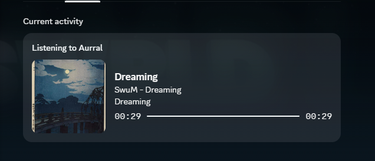

# Aurral Desktop

A lightweight desktop client for [Aurral](https://github.com/lklynet/aurral), built in Rust.

This app is a thin native WebView wrapper around your Aurral server's web frontend, so the desktop experience looks and behaves like the Aurral web app.


## Features

- **Native desktop app** for Aurral on Windows, Linux, and macOS
- **Web frontend parity** - uses the real Aurral web frontend for login, browsing, and playback
- **Server connect flow** - connect to any Aurral server by URL, with server validation and saved config
- **Settings window** - tray menu settings for desktop behavior and integrations
- **Discord Rich Presence** - shows your current track, artist, album, and album artwork in Discord (enabled by default)
- **System tray** - show/hide window, open settings, or quit
- **Close behavior** - choose whether closing the window exits the app or minimizes to tray

## Download

Prebuilt packages are available on the [GitHub Releases](https://github.com/Nevswrld/aurral-desktop/releases) page.

| Platform | Download | Notes |
| --- | --- | --- |
| Windows (x64) | `AurralDesktop-Setup-v*-windows-x64.exe` | Inno Setup installer |
| macOS (Apple Silicon) | `AurralDesktop-v*-macos-arm64.zip` | `.app` bundle |
| macOS (Intel) | `AurralDesktop-v*-macos-x64.zip` | `.app` bundle |
| Linux (Debian/Ubuntu) | `AurralDesktop-v*-linux-x64.deb` | Debian package |
| Linux (AppImage) | `AurralDesktop-v*-linux-x64.AppImage` | Portable AppImage |
| Linux (Flatpak bundle) | `AurralDesktop-v*-linux-x64.flatpak` | Flatpak single-file bundle |
| Linux (tarball) | `AurralDesktop-v*-linux-x64.tar.gz` | Portable tarball |

## Requirements

- A running [Aurral](https://github.com/lklynet/aurral) server
- **Windows**: Windows 10/11 with Microsoft Edge WebView2 Runtime
- **Linux**: WebKitGTK/GTK3 runtime. For the tarball on Debian/Ubuntu, install: `libwebkit2gtk-4.1-0 libgtk-3-0 libayatana-appindicator3-1`
- **macOS**: macOS 11+
- **Discord Rich Presence**: Discord desktop app running on the same machine

## Build from source

```bash
cargo build --release
```

The executable will be created at:

```text
target/release/aurral-desktop(.exe on Windows)
```

### Linux build dependencies (Debian/Ubuntu)

```bash
sudo apt-get install -y libwebkit2gtk-4.1-dev libgtk-3-dev libayatana-appindicator3-dev librsvg2-dev patchelf libxdo-dev libssl-dev
```

## Usage

1. Start the app.
2. Enter your Aurral server URL, for example `http://localhost:3001`.
3. Click **Connect**.
4. Sign in and use Aurral as you would in the browser.

The selected server URL is stored locally in your user config directory.

## Settings

Open **Settings** from the system tray icon menu.

- **Discord Rich Presence** - toggle showing your current track in Discord.
- **Close button behavior** - close the app or minimize to tray.
- **Clear server** - clear the saved server URL and return to the connect screen.

## Discord Rich Presence

Discord Rich Presence is enabled by default and preconfigured with the Aurral Desktop Discord Application ID. It shows the current track, artist, album, playback timing, and album artwork in Discord.



If your Aurral server provides a public artwork URL, that artwork is used. If the artwork URL is local/private, Aurral Desktop falls back to looking up public cover art online so Discord can display it.

You can override the Discord Application ID via `discord_app_id` in config or the `AURRAL_DISCORD_APP_ID` environment variable.

Config locations:

- **Windows**: `%APPDATA%\aurral\AurralDesktop\config\config.json`
- **Linux**: `~/.config/AurralDesktop/config.json`
- **macOS**: `~/Library/Application Support/org.aurral.AurralDesktop/config.json`

Example:

```json
{
  "server_url": "http://localhost:3001",
  "discord_enabled": true,
  "discord_app_id": "1575620457032454224",
  "close_behavior": "close"
}
```

## Notes

- Authentication and playback are handled by Aurral's web frontend/server.
- The desktop app renders the Aurral web frontend inside a native WebView for visual parity.
- To change servers, use **Settings > Clear server**.

## Aurral

- Docs: https://docs.aurral.org/api/overview/
- Source: https://github.com/lklynet/aurral
