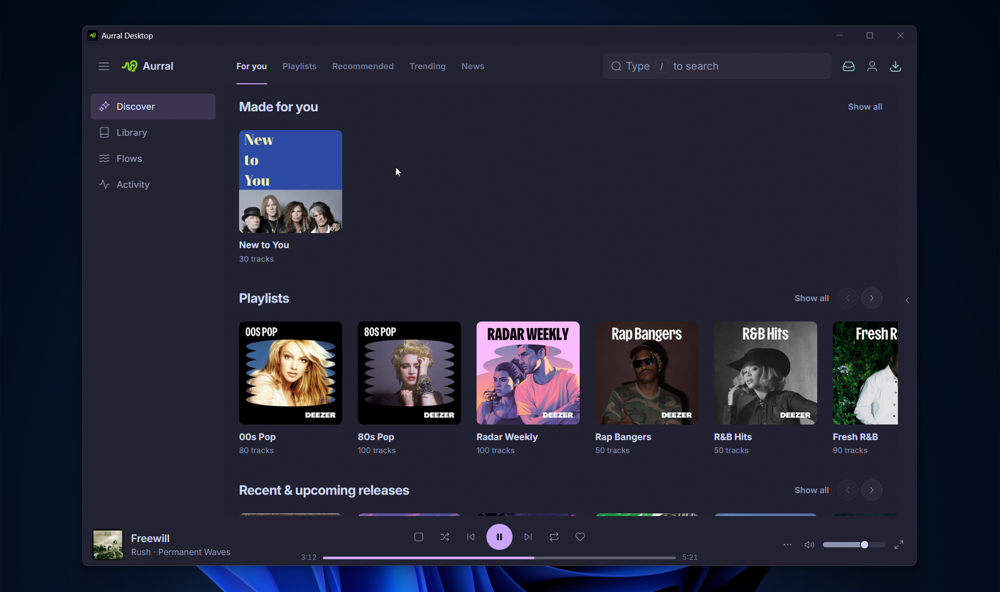

# Aurral Desktop

A lightweight desktop client for [Aurral](https://github.com/lklynet/aurral), built in Rust.

This app is a thin native WebView wrapper around your Aurral server's web frontend, so the desktop experience looks and behaves like the Aurral web app. It supports Windows, Linux, and macOS.



## Features

- Native desktop window for Aurral
- Connect to any Aurral server by URL
- Saves your server URL locally for next launch
- Uses the real Aurral web frontend for login, browsing, and playback
- Discord Rich Presence showing your current Aurral track
- Windows installer, Linux tarball, and macOS app bundle via GitHub Releases

## Download

Prebuilt installers/packages are available on the [GitHub Releases](https://github.com/Nevswrld/aurral-desktop/releases) page:

- **Windows**: `AurralDesktop-Setup-*.exe` (Inno Setup installer)
- **Linux**: `AurralDesktop-*-linux-x64.tar.gz`
- **macOS**: `AurralDesktop-*-macos-arm64.zip` (Apple Silicon `.app` bundle)

## Requirements

- A running Aurral server
- **Windows**: Windows 10/11 with Microsoft Edge WebView2 Runtime
- **Linux**: WebKitGTK and GTK3 (e.g. `libwebkit2gtk-4.1-dev`, `libgtk-3-dev` on Ubuntu/Debian)
- **macOS**: macOS 11+ (Apple Silicon build provided by release workflow)
- Rust stable toolchain for building from source

## Build

```bash
cargo build --release
```

The executable will be created at:

```text
target/release/aurral-desktop(.exe on Windows)
```

## Run

```bash
cargo run --release
```

## Usage

1. Start the app.
2. Enter your Aurral server URL, for example `http://localhost:3001`.
3. Click **Connect**.
4. Sign in and use Aurral as you would in the browser.

The selected server URL is stored locally in your user config directory.

## Discord Rich Presence

The desktop app can show your current Aurral track in Discord. To enable it, set a Discord Application ID in your config file:

- **Windows**: `%APPDATA%\aurral\AurralDesktop\config\config.json`
- **Linux**: `~/.config/AurralDesktop/config.json`
- **macOS**: `~/Library/Application Support/org.aurral.AurralDesktop/config.json`

Add `discord_app_id` (from the [Discord Developer Portal](https://discord.com/developers/applications)):

```json
{
  "server_url": "http://localhost:3001",
  "discord_enabled": true,
  "discord_app_id": "YOUR_DISCORD_APPLICATION_ID"
}
```

You can also set the `AURRAL_DISCORD_APP_ID` environment variable. Discord must be running on the same machine.

## Notes

- The desktop app renders the Aurral web frontend inside a native WebView for visual parity with the web app.
- Authentication and playback are handled by Aurral's web frontend/server.
- To change servers, clear the saved config in your user config directory or reinstall with a fresh config.

## Aurral

- Docs: https://docs.aurral.org/api/overview/
- Source: https://github.com/lklynet/aurral
